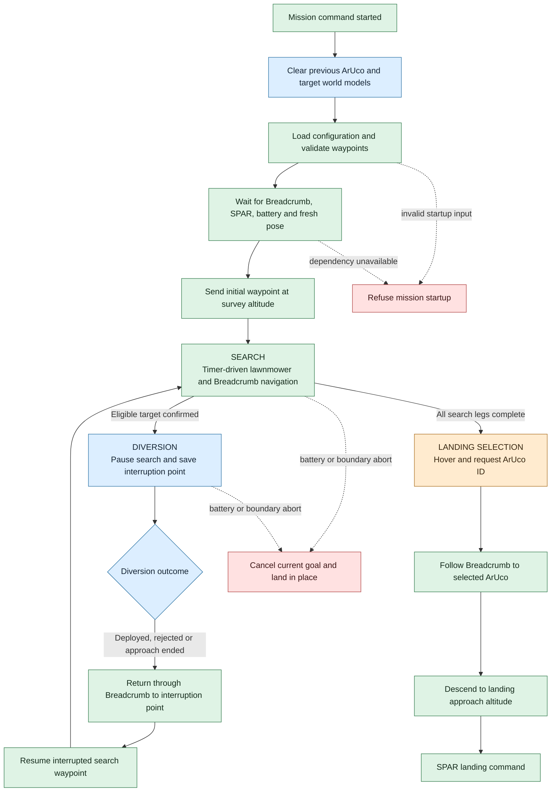
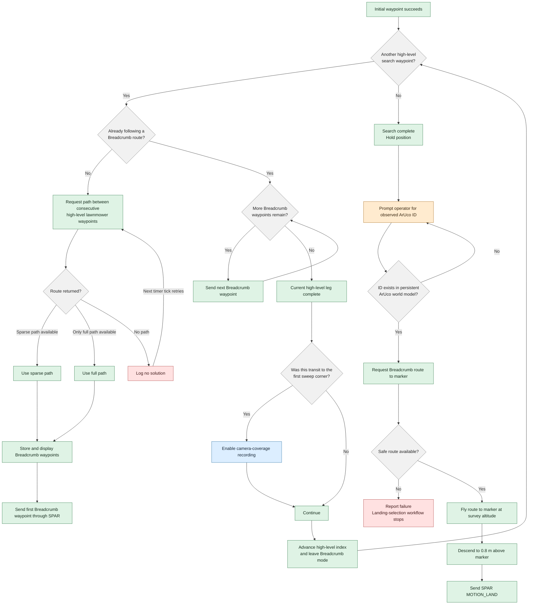

# EGH450 System Code Guide

This guide documents the project code used by the image-processing, navigation, operator-interface and payload subsystems. Generated build files, ROS dependencies and archived experiments are excluded from the active hierarchy.

## 1. Active file hierarchy

### Subsystem key

| Symbol | Subsystem | Primary responsibility |
| --- | --- | --- |
| 🔵 | Image processing | Camera pipeline, ArUco processing, object detection, target localisation and world-model output |
| 🟢 | Navigation | Mission decisions, path planning, flight-motion commands and vehicle supervision |
| 🟠 | Operator interface | RQT/RViz presentation, status displays, voice announcements and launch controls |
| 🟣 | Payload | Physical EpiPen/tracker deployment control |
| ⚪ | Shared interface/configuration | ROS messages, services and configuration used across subsystem boundaries |
| ⚫ | Build/support | ROS executable wrappers and package metadata; required to run the code but not mission logic |

### Workspace layout

```text
catkin_ws_G6/
│
├── 🔵 src/depthai_publisher/                  Camera and target-processing package
│   ├── 🔵 src/depthai_publisher/
│   │   ├── dai_publisher.py                  OAK-D RGB, depth and YOLO pipeline
│   │   ├── aruco_subscriber.py               ArUco image-processing node
│   │   ├── aruco_pose_estimator_PnP.py       ArUco camera-relative pose estimation
│   │   ├── aruco_global_transform.py         ArUco camera-to-map transformation
│   │   ├── camera_to_map.py                  Shared camera-to-map geometry
│   │   ├── object_position_estimator.py      YOLO detection and depth to map position
│   │   ├── target_world_model.py             Persistent target markers and target labels
│   │   ├── vision_overlay.py                 Combined operator image overlay
│   │   ├── 🟠 object_announcer.py            GCS object-announcement ROS node
│   │   ├── 🟠 object_announcer_core.py       Object-announcement rules
│   │   ├── 🟠 mission_announcer.py           GCS mission-announcement ROS node
│   │   ├── 🟠 mission_announcer_core.py      Mission-announcement rules
│   │   ├── launch/image_topics.launch        Active image-pipeline launcher
│   │   └── models/
│   │       ├── egh450_yolo5_coco_v2/         Active 80-class COCO model assets
│   │       └── other model directories       Retained alternatives; not active by default
│   ├── 🟠 launch/
│   │   ├── object_announcer.launch
│   │   └── mission_announcer.launch
│   ├── ⚪ msg/
│   │   ├── ArucoDetection.msg
│   │   ├── ArucoDetectionArray.msg
│   │   ├── TargetObservation.msg
│   │   └── TargetObservationArray.msg
│   ├── ⚪ config/target_confidence.yaml        Shared detector/mission confidence settings
│   ├── ⚫ scripts/                            Thin ROS executable wrappers and utilities
│   └── ⚫ test/                               Announcer unit tests
│
├── 🟢 src/spar/spar_node/                   Mission and flight-motion package
│   ├── 🟢 scripts/test_breadcrumb_camera Main autonomous mission script
│   ├── 🟢 launch/nav_mission.launch     Mission launcher and subsystem integration
│   ├── 🟢 src/spar_node.cpp             SPAR ROS node entry point
│   ├── 🟢 src/spar_node/spar.cpp        SPAR flight-motion implementation
│   ├── 🟢 include/spar_node/Spar.h      SPAR class interface
│   ├── 🟢 launch/spar*.launch           Real/emulated SPAR launch variants
│   ├── 🟢 scripts/{goto,takeoff,land}    Manual flight-command utilities
│   ├── 🟣 scripts/payload-v1.2.py       GPIO payload controller
│   ├── 🟠 rviz/onboard_config.rviz      Onboard RViz display configuration
│   └── scripts/unused/                            Archived scripts; not active mission code
│
├── 🟢 src/breadcrumb/                       Obstacle-aware route-planning package
│   ├── src/breadcrumb_node.cpp                    Breadcrumb ROS node entry point
│   ├── src/breadcrumb/breadcrumb.cpp              Path-request and occupancy-grid handling
│   ├── src/breadcrumb/AStar.cpp                   A* path search
│   ├── include/breadcrumb/                        C++ class interfaces
│   ├── ⚪ srv/RequestPath.srv                 Mission-to-Breadcrumb service contract
│   ├── ⚪ cfg/AStarParams.cfg                 Planner configuration interface
│   └── launch/breadcrumb.launch                   Breadcrumb node launcher
│
├── ⚪ src/spar/spar_msgs/
│   └── action/FlightMotion.action                Mission-to-SPAR action contract
│
├── 🟠 src/qutas_lab_450/
│   ├── launch/environment.launch                  Arena map/environment launcher
│   ├── launch/dashboard.launch                    RQT dashboard launcher
│   ├── config/dashboard*.perspective              Saved RQT dashboard layouts
│   └── src/{area_map,area_viz}*                   Occupancy-map and arena visualisation
│
├── 🟠 src/rqt_mavros_gui/                   Vehicle control/status RQT plugin
├── 🟠 src/rqt_generic_hud/                   Generic flight-data HUD plugin
├── 🟠 src/rqt_eyedropper/                    Image colour-inspection RQT plugin
├── 🟠 src/rqt_quaternion_view/               Attitude/quaternion RQT plugin
│
├── 🟠 scripts/egh_status_dashboard.py       Real-flight terminal status display
└── 🟠 scripts/egh_emulator_status_dashboard.py
                                                    Emulator terminal status display
```

The onboard launch helpers are defined outside the repository in `/home/uavteam6/.bashrc`. They create the real-flight or emulator tmux session, prepare its command prompts and provide the shared `kill450` cleanup command. The corresponding GCS launch helpers belong to the GCS Raspberry Pi and must be copied into this guide from that device rather than inferred from the onboard version.

### Runtime placement

| Computer | Runtime responsibility | Relevant source location |
| --- | --- | --- |
| Onboard Raspberry Pi | OAK-D pipeline, ArUco and target processing, target world model, autonomous mission, Breadcrumb, SPAR and payload control | This `catkin_ws_G6` workspace |
| Ground-control Raspberry Pi | RQT/RViz operator displays, voice-announcement processes and operator launch controls | Announcer source is retained in `depthai_publisher`; the deployed GCS launch functions/configuration must be documented from the GCS workspace |
| Flight controller | Low-level vehicle estimation and control reached through MAVROS/SPAR | Firmware/external subsystem; not part of this code hierarchy |

The announcer files are coloured orange because they are operator-interface code even though their source copy is stored inside the image-processing ROS package.

### Files intentionally excluded from the active hierarchy

- `build/`, `devel/` and ROS log directories are generated outputs.
- `src/spar/spar_node/scripts/unused/` contains backups and superseded mission experiments.
- Model-training notebooks, bag conversion utilities and diagnostic capture instructions support development but do not run during a mission.
- ROS dependencies and unmodified third-party packages are outside the scope of this project-code guide.

## 2. Script and function responsibilities

ROS names beginning with `/` are absolute runtime names. SPAR's private names are remapped by its real-flight or emulator launch file.

### 2.1 Image processing

#### `dai_publisher.py`

Runs the OAK-D pipeline. It publishes the source imagery, calibration, aligned depth and filtered person/backpack detections. The optional diagnostic outputs expose the exact neural-network input and the decoder output before application-class filtering.

| Direction | ROS interface | Type/purpose |
| --- | --- | --- |
| Output | `/depthai_node/image/compressed` | Operator RGB image (`CompressedImage`) |
| Output | `/depthai_node/image/raw` | Uncompressed RGB image (`Image`) |
| Output | `/depthai_node/camera/camera_info` | OAK-D calibration (`CameraInfo`) |
| Output | `/depthai_node/depth/aligned` | RGB-aligned depth (`Image`) |
| Output | `/yolo/detections` | Person/backpack `Detection2DArray`, with COCO backpack remapped from class 24 to application class 1 |
| Optional output | `/depthai_node/nn_input` | Exact resized/padded neural-network input |
| Optional output | `/yolo/raw_detections` | Unfiltered decoder detections using source COCO class IDs |

| Function | Responsibility |
| --- | --- |
| `DepthaiCamera.__init__()` | Loads ROS settings, creates publishers and prepares the DepthAI pipeline. |
| `read_yolo_config()` | Reads input dimensions, class count, anchors, masks and decoder thresholds from the selected model JSON. |
| `configure_pipeline()` | Creates the RGB camera and connects the enabled depth and YOLO branches. |
| `configure_depth_pipeline()` | Produces stereo depth aligned to the RGB image. |
| `configure_yolo_pipeline()` | Configures the OAK neural-network node from the paired JSON/blob assets. |
| `read_camera_info()` | Reads the OAK calibration and creates the ROS `CameraInfo`. |
| `run()` | Opens the camera, retrieves output queues, assigns matching timestamps/sequence numbers and publishes frames. |
| `publish_nn_input()` | Publishes the exact tensor image supplied to the detector when diagnostics are enabled. |
| `publish_raw_yolo_detections()` | Publishes every decoder result before person/backpack filtering and class remapping. |
| `publish_depth_to_ros()` | Converts and publishes one aligned depth frame. |
| `publish_yolo_detections()` | Filters for person/backpack, remaps class IDs and publishes 2D boxes. |
| `publish_to_ros()` | Publishes RGB raw/compressed images and matching camera calibration. |
| `shutdown()` | Closes the active OAK device cleanly. |
| `main()` | Starts the ROS node and runs the camera loop. |

#### ArUco processing

`aruco_subscriber.py` detects markers in every RGB frame, obtains camera-relative pose through `aruco_pose_estimator_PnP.py`, converts valid poses into the map frame through `aruco_global_transform.py`, and retains one world marker per ArUco ID.

| Direction | ROS interface | Type/purpose |
| --- | --- | --- |
| Input | `/depthai_node/image/compressed` | Source RGB frame |
| Input | `/depthai_node/camera/camera_info` | Camera calibration |
| Input | `/mavros/local_position/pose` or `/uavasr/pose` | Timestamp-compatible aircraft pose |
| Output | `/aruco/observations` | Per-frame image-space ArUco observations, including empty frames |
| Output | `/world_model/aruco_markers` | Latched map-frame RViz marker array |
| Service | `/world_model/clear_aruco` | Clears retained ArUco locations and RViz markers |

| File/function | Responsibility |
| --- | --- |
| `ArucoDetector.__init__()` | Creates inputs/outputs, detector helpers and the persistent marker store. |
| `clear_markers()` | Clears stored marker IDs and sends RViz deletion markers. |
| `store_marker()` | Stores the newest valid map pose for one marker ID. |
| `publish_marker_array()` | Publishes marker shapes and text labels containing ID and XYZ. |
| `pose_callback()` | Retains the latest aircraft pose independently of image arrival. |
| `image_callback()` | Decodes an RGB image, selects a sufficiently fresh pose and starts detection. |
| `info_callback()` | Supplies calibration to the PnP estimator. |
| `find_aruco()` | Detects marker borders/IDs, estimates pose, publishes per-frame observations and updates valid world positions. |
| `aruco_subscriber.main()` | Starts the ArUco node. |
| `ArucoPoseEstimator.__init__()` | Defines marker geometry and PnP quality limits. |
| `set_camera_info()` | Stores the camera matrix and distortion coefficients. |
| `estimate_pose()` | Solves marker pose and rejects invalid/high-error PnP results. |
| `draw_pose_overlay()` | Draws axes and pose text for an accepted marker. |
| `draw_text_180()` | Draws text in the orientation required by the camera presentation. |
| `ArucoGlobalTransformer.build_camera_marker_transform()` | Converts PnP rotation/translation into a homogeneous camera-to-marker transform. |
| `ArucoGlobalTransformer.camera_to_world()` | Composes map-to-drone, drone-to-camera and camera-to-marker transforms. |
| `ArucoGlobalTransformer.print_marker_pose()` | Produces the terminal pose summary. |

#### `camera_to_map.py`

Provides shared rigid-body transformation helpers used by ArUco and object localisation. It has no ROS publishers or subscribers of its own.

| Function | Responsibility |
| --- | --- |
| `build_map_drone_transform()` | Builds the map-to-aircraft transform from a ROS pose. |
| `build_drone_camera_transform()` | Builds the fixed aircraft-to-OAK mounting transform. |
| `camera_point_to_map()` | Transforms one XYZ point from the optical camera frame into the map frame. |

#### `object_position_estimator.py`

Pairs each YOLO result with the depth frame from the same capture time, samples a small central depth patch, deprojects it with camera calibration and transforms the resulting point into map coordinates using the closest recorded aircraft pose.

| Direction | ROS interface | Type/purpose |
| --- | --- | --- |
| Input | `/yolo/detections` | Filtered 2D person/backpack boxes |
| Input | `/depthai_node/depth/aligned` | Same-timestamp depth frame |
| Input | `/depthai_node/camera/camera_info` | Camera calibration |
| Input | Configured real/emulator pose topic | Pose history used for timestamp alignment |
| Output | `/objects/observations` | Compatibility `Detection3DArray` output |
| Output | `/objects/target_observations` | Per-frame target class, confidence, box and optional map position |

| Function | Responsibility |
| --- | --- |
| `__init__()` | Creates synchronized detection/depth inputs, pose history and publishers. |
| `camera_info_callback()` | Stores calibration for pixel deprojection. |
| `pose_callback()` | Adds a stamped aircraft pose to the bounded history. |
| `pose_for_stamp()` | Finds the history entry closest to the source image time and enforces the pose-age limit. |
| `publish_outputs()` | Publishes both observation formats with matching source timing. |
| `perception_callback()` | Processes each detection independently; invalid depth or pose removes only that detection's map validity. |
| `estimate_camera_point()` | Takes the median valid depth from the central patch and deprojects the box centre into camera XYZ. |
| `build_target_observation()` | Copies class, confidence and image-box data into the application message. |
| `build_detection_3d()` | Builds the compatibility 3D detection at the estimated map point. |
| `main()` | Starts the estimator node. |

#### `target_world_model.py`

Owns perception-side temporal confirmation and persistent RViz target memory. It applies the shared confidence and minimum-coverage gates per detection, performs 3-of-5 spatial confirmation, remembers accepted targets and responds to mission-side injected, rejected and locked locations.

| Direction | ROS interface | Type/purpose |
| --- | --- | --- |
| Input | `/objects/target_observations` | Every target-observation frame, including empty frames |
| Input | `/objects/injected_test_target` | Explicit terminal-injected test target |
| Input | `/objects/rejected_target` | Location removed/hidden by mission policy or operator veto |
| Input | `/objects/locked_target` | Final location frozen by navigation |
| Output | `/objects/confirmed_targets` | Targets currently satisfying initial confirmation |
| Output | `/world_model/target_markers` | Latched backpack/person shapes and XYZ labels for RViz |
| Service | `/world_model/clear_targets` | Clears retained targets and markers between missions |

| Function | Responsibility |
| --- | --- |
| `__init__()` | Loads shared class thresholds and creates the world-model interfaces. |
| `clear_targets()` | Clears frame history, remembered/rejected targets and RViz markers. |
| `observation_callback()` | Applies confidence, coverage and map-validity gates to one incoming frame. |
| `bounding_box_coverage_percent()` | Calculates box area as a percentage of the source frame area. |
| `injected_target_callback()` | Adds an explicit test target to persistent display memory. |
| `rejected_target_callback()` | Removes nearby remembered targets and suppresses the rejected location. |
| `locked_target_callback()` | Replaces a provisional remembered location with navigation's frozen location. |
| `delete_markers()` | Publishes RViz deletion commands for specified marker IDs. |
| `observation_distance()` | Measures XY separation between two target observations. |
| `position_distance()` | Measures XY separation between two positions. |
| `find_confirmed_targets()` | Finds same-class detections present in at least three of the last five frames within the association radius. |
| `update_remembered_targets()` | Adds or updates persistent targets without duplicating nearby instances. |
| `publish_markers()` | Publishes class-specific shapes, colours and XYZ text labels. |
| `publish_confirmed_targets()` | Publishes the current 3-of-5 results for mission consumption. |
| `main()` | Starts the world-model node. |

#### `vision_overlay.py`

Joins image, ArUco and YOLO messages by their source timestamps, draws presentation overlays and publishes one operator image. It does not make mission decisions.

| Direction | ROS interface | Type/purpose |
| --- | --- | --- |
| Input | `/depthai_node/image/compressed` | Source RGB image |
| Input | `/depthai_node/camera/camera_info` | Calibration for projected ArUco axes |
| Input | `/aruco/observations` | Same-frame ArUco corners/poses |
| Input | `/yolo/detections` | Same-frame object boxes |
| Input | `/target/events` | Short mission-side target status messages |
| Output | `/processed_image/compressed` | Combined labelled image for RQT/RViz |

| Function | Responsibility |
| --- | --- |
| `__init__()` | Creates timestamp caches, subscribers, output publisher and flush timer. |
| `target_event_callback()` | Prints formatted target-event messages in the imagery pane. |
| `read_yolo_labels()` | Defines application class labels and colours. |
| `camera_info_callback()` | Stores calibration used for ArUco projection. |
| `stamp_key()` | Converts a ROS message stamp into an exact cache key. |
| `store_bounded()` | Inserts a cached item while enforcing the configured cache limit. |
| `image_callback()` | Caches a source image until matching results arrive or the delay expires. |
| `aruco_callback()` | Caches ArUco results by source time. |
| `yolo_callback()` | Caches YOLO results by source time. |
| `flush_ready_images()` | Publishes images once results are available or the bounded wait expires. |
| `publish_overlay()` | Decodes, annotates and republishes one frame. |
| `draw_yolo_detection()` | Draws one class-coloured box and label. |
| `draw_aruco_observation()` | Draws one marker border, ID and optional pose axes. |
| `draw_text()` | Draws readable outlined overlay text. |
| `main()` | Starts the overlay node. |

### 2.2 Navigation

#### `test_breadcrumb_camera`

This is the active autonomous mission script. It preserves the recognisable waypoint/Breadcrumb mission structure while integrating target diversion, final visual confirmation, payload selection, ArUco landing selection and runtime safety supervision.

| Direction | ROS interface | Purpose |
| --- | --- | --- |
| Input | Configured real/emulator pose topic | Current aircraft position |
| Input | Configured battery topic | Startup and runtime battery supervision |
| Input | `/objects/target_observations` | Recent boxes and map estimates for approach/final confirmation |
| Input | `/objects/confirmed_targets` | Initial 3-of-5 diversion authorisation |
| Input | `/world_model/aruco_markers` | Stored landing-marker IDs and map positions |
| Input | `/grid` | Occupancy map used to place injected test targets safely |
| Client | `/breadcrumb/request_path` | Obstacle-aware path requests |
| Client | `spar/flight` | Flight-motion action requests |
| Output | `/guidance/fullPath` | High-level lawnmower route for RViz |
| Output | `/guidance/pathBreadcrumb` | Current obstacle-aware route for RViz |
| Output | `/guidance/droneTrail` | Resettable travelled path marker |
| Output | `/guidance/cameraCoverage` | Camera footprint accumulated during the search sweep |
| Output | `/target/events` | Detected, confirmed, rejected and ignored target messages |
| Output | `/objects/rejected_target` | World-model marker removal/suppression request |
| Output | `/objects/locked_target` | Frozen final target location |
| Output | `/objects/injected_test_target` | RViz/world-model representation of a fake target |
| Output | `/actuator_control/actuator_a` | EpiPen servo command |
| Output | `/actuator_control/actuator_b` | Tracker servo command |
| Services | `/mission/inject_person`, `/mission/inject_backpack` | Terminal-triggered test diversions |

##### Mission setup, safety and vehicle state

| Function | Responsibility |
| --- | --- |
| `Guidance.__init__()` | Loads mission state/configuration, creates ROS interfaces, waits for dependencies and starts the first mission movement. |
| `check_waypoints()` | Validates the complete high-level waypoint list. |
| `check_waypoint()` | Rejects malformed/non-finite waypoints and, when enabled, points outside the mission boundary. |
| `callback_battery()` | Stores battery telemetry and aborts for invalid or at/below 20% readings. |
| `battery_ready()` | Confirms battery telemetry is present, valid and recent. |
| `abort_mission()` | Prevents further mission/deployment activity and commands an in-place landing after flight has begun. |
| `abort_landing_done()` | Reports whether an abort landing succeeded. |
| `wait_for_motion()` | Waits for the current SPAR action while continuing safety checks. |
| `check_live_boundary()` | Monitors the measured aircraft position against the enabled boundary. |
| `shutdown()` | Stops timers/subscribers and cancels the active motion unless already landing. |
| `start_pose_input()` | Selects real/emulator pose type and refuses startup without a fresh position. |
| `pose_ready()` | Tests reception time and ROS timestamp freshness. |
| `accept_pose()` | Validates and stores position, then updates boundary, trail and coverage state. |
| `callback_pose()` | Adapts real-flight `PoseStamped` input to `accept_pose()`. |
| `callback_odom()` | Adapts emulator `Odometry` input to `accept_pose()`. |
| `update_drone_trail()` | Adds a trail point after at least 0.20 m of movement. |
| `publish_drone_trail()` | Publishes the current mission's line-strip marker. |

##### Search, Breadcrumb and SPAR movement

| Function | Responsibility |
| --- | --- |
| `display_path()` | Converts waypoint arrays into latched RViz `Path` messages. |
| `request_breadcrumb_path()` | Requests and validates one obstacle-aware route from the current aircraft position. |
| `follow_breadcrumb_route()` | Sends every point of a finite Breadcrumb route through SPAR. |
| `return_to_interruption_point()` | Replans safely to the saved diversion point, then reaches that exact point before search resumes. |
| `send_wp()` | Builds and sends a SPAR `MOTION_GOTO` goal with boundary/battery checks. |
| `check_waypoint_status()` | Periodic legacy mission supervisor that advances Breadcrumb points and high-level search legs, then enters landing selection after the sweep. |

##### Camera coverage and ArUco landing

| Function | Responsibility |
| --- | --- |
| `camera_info_callback()` | Stores focal lengths and image dimensions used for the footprint calculation. |
| `update_camera_coverage()` | Adds a ground-footprint rectangle after the search sweep has begun. |
| `publish_camera_coverage()` | Publishes accumulated footprint outlines to RViz. |
| `callback_aruco_markers()` | Updates the available landing-marker ID-to-position dictionary. |
| `begin_manual_selection()` | Stops automatic search progression and prompts the operator for an ArUco ID. |
| `wait_for_landing_selection()` | Reads and validates the operator's selected marker ID. |
| `fly_landing_location()` | Uses Breadcrumb to reach the selected marker before the landing descent. |
| `send_land_motion()` | Sends SPAR's vertical `MOTION_LAND` command. |

##### Target evidence, test injection and diversion

| Function | Responsibility |
| --- | --- |
| `publish_target_event()` | Formats target state, class, confidence, XYZ and reason for imagery/GCS consumers. |
| `publish_rejected_target_location()` | Tells the world model to remove and suppress a rejected location. |
| `publish_locked_target_location()` | Tells the world model to freeze navigation's final target location. |
| `publish_target_location()` | Builds the shared `Detection3D` location message used by the previous two functions. |
| `target_coverage_percent()` | Calculates one observation's box coverage from its source image dimensions. |
| `target_observations_are_stable()` | Checks whether the retained target positions satisfy the configured convergence spread. |
| `update_active_target()` | Associates fresh observations with the target currently being investigated. |
| `record_active_target_frame()` | Adds one matched observation or miss to the rolling five-frame window. |
| `latest_active_target_position()` | Returns the latest qualifying rolling-median target location. |
| `wait_for_final_target_confirmation()` | Allows up to three seconds for fresh, centred, stable 3-of-5 evidence while holding. |
| `callback_object_observations()` | Supplies live frames to active approach/final-confirmation tracking. |
| `callback_test_target_grid()` | Retains the newest occupancy grid for fake-target placement. |
| `test_grid_cell_is_clear()` | Checks the selected cell and clearance radius for obstacles. |
| `select_test_target_location()` | Randomly selects an in-bound, obstacle-free point within 2 m of the aircraft. |
| `callback_inject_person()` | Handles the person injection service. |
| `callback_inject_backpack()` | Handles the backpack injection service. |
| `inject_test_target()` | Creates the requested test candidate and initiates its diversion. |
| `publish_injected_test_target()` | Publishes the fake location and visible `TEST` marker data. |
| `start_target_diversion()` | Reserves mission control for one accepted target and starts the diversion worker. |
| `target_location_rejected()` | Tests whether a candidate lies near a blacklisted location. |
| `reject_target_location()` | Adds a location to the per-class mission blacklist. |
| `target_retry_state()` | Determines whether a location is new, cooling down or eligible for its second attempt. |
| `schedule_target_retry()` | Records the first failed attempt and begins the cooldown. |
| `consume_target_retry()` | Marks the permitted post-cooldown retry as used. |
| `callback_confirmed_targets()` | Filters world-model confirmations against mission state, payload availability, serviced locations, cooldown and blacklist policy. |
| `run_target_diversion()` | Executes the reserved target diversion outside the subscriber callback. |
| `occupancy_grid_cell()` | Converts a map position to occupancy-grid indices. |
| `exact_target_is_in_route_endpoint_cell()` | Confirms that exact final positioning remains inside Breadcrumb's safe endpoint cell. |
| `refine_target_while_flying()` | Updates the provisional destination from the rolling median during the bounded dynamic approach. |
| `fly_to_rolling_target()` | Runs the three-second dynamic refinement, freezes a destination and completes the obstacle-safe/final exact approach. |
| `callback_inspect_roi()` | Orchestrates diversion, final confirmation, descent, veto/deployment, climb, return to interruption point and search resumption. |
| `wait_for_operator_rejection()` | Shows the five-second deployment countdown and detects an `R` veto from an interactive terminal. |
| `deploy_payload()` | Selects EpiPen/tracker actuator, prevents duplicate release and publishes the servo-open command. |

##### Module-level functions

| Function | Responsibility |
| --- | --- |
| `clear_previous_world_model()` | Calls the ArUco and target clear services before constructing a new mission. |
| `main()` | Defines the lawnmower search waypoints, clears previous map state and starts `Guidance`. |

#### Breadcrumb package

Breadcrumb receives an occupancy grid and returns a collision-free route between requested map points. Its sparse response removes unnecessary collinear intermediate points; navigation still treats the response as a finite sequence of SPAR waypoints.

| Direction | ROS interface | Purpose |
| --- | --- | --- |
| Input | `/grid` | Arena occupancy grid |
| Service | `/breadcrumb/request_path` | Start/end request; full and sparse `PoseArray` response |
| Configuration | Dynamic reconfigure `AStarParams` | Grid/path-planner behaviour |

| File/function | Responsibility |
| --- | --- |
| `breadcrumb_node.cpp::main()` | Starts the ROS Breadcrumb node. |
| `Breadcrumb::Breadcrumb()` | Creates the grid subscriber, dynamic configuration and path service. |
| `callback_cfg_settings()` | Applies updated A* settings. |
| `request_path()` | Converts metric points to grid coordinates, runs the planner and returns map-frame full/sparse paths. |
| `callback_grid()` | Stores the occupancy grid and rebuilds planner collision cells. |
| `snapToNearestFree_()` | Moves a blocked request endpoint to the nearest usable grid cell. |
| `AStar::Generator::findPath()` | Searches from source to target and returns the grid route. |
| `computeCost()` | Computes successor cost, including Theta* parent shortcuts when enabled. |
| `lineOfSight()` | Tests whether two grid nodes can be joined without crossing a collision. |
| `setWorldSize()`, `setDiagonalMovement()`, `setHeuristic()`, `setThetaStar()` | Configure the search space and algorithm. |
| `addCollision()`, `removeCollision()`, `clearCollisions()`, `detectCollision()` | Maintain/query occupied cells. |
| `findNodeOnList()`, `releaseNodes()` | Internal open/closed-list memory handling. |
| `Heuristic::{manhattan,euclidean,octagonal}()` | Available A* distance estimates. |

#### SPAR package

SPAR converts a high-level `FlightMotion` action into a continuously published MAVROS/emulator position target. It owns the interpolation and convergence of an individual movement, not the mission sequence.

| Direction | Private ROS interface | Purpose |
| --- | --- | --- |
| Input | `~pose` | Current aircraft pose |
| Input | `~mav_state` | Connection, flight mode and armed state |
| Action server | `~flight` | STOP, GOTO, TAKEOFF and LAND commands |
| Output | `~setpoint` | Position/velocity target for MAVROS or the emulator |

| Function | Responsibility |
| --- | --- |
| `Spar::Spar()` | Loads settings, creates ROS interfaces and registers action callbacks. |
| `type_mask_from_motion()` | Selects position- or velocity-control fields for each motion type. |
| `stop_at_current_location()` | Changes the output to a hold at the measured pose. |
| `cancel_goal()` | Holds position and aborts the active action. |
| `yaw_from_quaternion()`, `shortest_angle()`, `wrap_pi()`, `calc_unwraped_yaw()` | Handle yaw conversion/interpolation without discontinuities. |
| `duration_from_distance()`, `duration_from_distance_2d()` | Calculate nominal motion time from distance and speed. |
| `cb_act_goal()` | Validates a new action and prepares start/end state and duration. |
| `cb_act_preempt()` | Handles action cancellation/preemption. |
| `check_start_as()` | Starts accepting actions only after valid pose, connection, OFFBOARD mode and arming. |
| `cb_mav_state()` | Stores the latest vehicle state. |
| `cb_pose()` | Stores the latest aircraft pose. |
| `is_waiting_for_convergence()` | Applies the requested final position/yaw tolerances. |
| `cb_timer()` | Interpolates the active motion, publishes setpoints/feedback and completes actions. |
| `spar_node.cpp::main()` | Starts SPAR and the ROS callback loop. |

#### Navigation utility scripts

| Script | Responsibility |
| --- | --- |
| `goto` | Sends one manually entered GOTO action to SPAR. |
| `takeoff` | Sends a standalone take-off action. |
| `land` | Sends a standalone landing action. |
| `demo_wp` | Demonstrates waypoint-action use; not the autonomous mission. |
| `takeoff_and_land` | Combined demonstration script; not part of the normal mission launch. |

### 2.3 Payload

#### `payload-v1.2.py`

Converts Boolean ROS commands into 50 Hz PWM movement on Raspberry Pi GPIO 12 and 13. Servo A carries the EpiPen for a person; Servo B carries the tracker for a backpack.

| Direction | ROS interface | Purpose |
| --- | --- | --- |
| Input | `/actuator_control/actuator_a` | `True` opens and `False` closes Servo A |
| Input | `/actuator_control/actuator_b` | `True` opens and `False` closes Servo B |
| Hardware output | GPIO 12 / GPIO 13 | PWM command to the two servos |

| Function | Responsibility |
| --- | --- |
| `callback_a()` | Moves Servo A open/closed, waits for travel and removes holding pulses. |
| `callback_b()` | Performs the equivalent command for Servo B. |
| `shutdown()` | Unregisters subscribers, stops PWM and releases GPIO resources. |
| Module startup block | Creates the ROS node/subscribers and configures both PWM channels. |

The script confirms that a PWM movement command was issued; it does not receive physical position feedback from the servos.

### 2.4 Operator interfaces and announcements

#### `object_announcer.py` and `object_announcer_core.py`

Run on the GCS. Target state messages are spoken immediately; persistent ArUco markers are gated so a repeated latched marker does not produce continuous announcements.

| Direction | ROS interface | Purpose |
| --- | --- | --- |
| Input | `/target/events` | Mission target detected/confirmed/rejected/ignored messages |
| Input | `/world_model/aruco_markers` | Persistent ArUco map markers |
| Output | `/gcs/target_alert` | Latched text of the latest spoken target alert |
| Process output | `spd-say` | Audible announcement on the GCS |

| Function/class | Responsibility |
| --- | --- |
| `SpeechWorker` | Queues speech in a background thread so callbacks do not block. |
| `SpeechWorker.say()` / `_run()` / `shutdown()` | Queue, execute and cleanly stop speech work. |
| `ObjectAnnouncer.report()` | Builds a position announcement from a target type and XYZ. |
| `announce()` | Logs, republishes and speaks one phrase. |
| `target_event_callback()` | Converts the mission event string into an allowed announcement. |
| `aruco_callback()` | Announces only fresh map-frame markers that pass the gate. |
| `TargetAnnouncementGate.reset()` | Clears remembered announcement history at a world-model reset. |
| `TargetAnnouncementGate.update()` | Confirms repeated spatially matched observations and applies deduplication/cooldown. |
| `announcement_text()` | Formats a labelled XYZ announcement. |
| `target_event_announcement()` | Maps target event strings to concise speech. |

#### `mission_announcer.py` and `mission_announcer_core.py`

Run on the GCS. They translate vehicle state, selected mission log events and payload commands into speech without modifying mission behaviour.

| Direction | ROS interface | Purpose |
| --- | --- | --- |
| Input | `/mavros/state` | Armed/disarmed transitions |
| Input | `/rosout_agg` | Selected mission progress log messages |
| Input | `/actuator_control/actuator_a`, `/actuator_control/actuator_b` | Payload-release commands |
| Output | `/gcs/mission_alert` | Latched text of the latest spoken mission alert |
| Process output | `spd-say` | Audible GCS announcement |

| Function/class | Responsibility |
| --- | --- |
| `SpeechWorker` | Non-blocking speech queue and worker lifecycle. |
| `MissionAnnouncer.announce()` | Logs, republishes and speaks one phrase. |
| `state_callback()` | Announces armed/disarmed transitions and resets per-mission deduplication on arming. |
| `log_callback()` | Recognises selected mission messages and speaks each event once per run. |
| `payload_a_callback()`, `payload_b_callback()` | Identify which physical payload command was received. |
| `payload_callback()` | Announces each `True` deployment command; ignores servo reset/close commands. |
| `mission_event_announcement()` | Maps recognised node/log combinations to mission phrases. |
| `payload_announcement()` | Maps actuator A/B to EpiPen/tracker deployment speech. |

#### Terminal status dashboards

| Script/function | Responsibility |
| --- | --- |
| `egh_status_dashboard.py::Dashboard` | Summarises ROS master, Breadcrumb, MAVROS/Pixhawk, SPAR, real pose, battery and DepthAI readiness. |
| `egh_emulator_status_dashboard.py::Dashboard` | Equivalent display for emulator node, state, pose, odometry and battery topics. |
| Subscriber callbacks | Record the most recent data/reception times. |
| `registration()` / `registrations()` | Queries the ROS master for active nodes, topics and services. |
| `run()` | Refreshes the terminal summary and prints the most relevant next action. |

These dashboards are diagnostic displays. They do not start, stop or block the mission.

#### Arena and graphical interfaces

| Package/file | Input | Output/responsibility |
| --- | --- | --- |
| `qutas_lab_450/area_map` | Arena/map launch configuration | Publishes the `/grid` occupancy map used by Breadcrumb and test injection. |
| `qutas_lab_450/area_viz` | `/grid` | Publishes RViz wall/map markers. |
| `qutas_lab_450/config/dashboard*.perspective` | Saved RQT settings | Defines the dashboard plugin layout. |
| `rqt_mavros_gui` | MAVROS state/services | Operator flight state and control plugin. |
| `rqt_generic_hud` | Configured flight topics | Generic telemetry HUD. |
| `rqt_eyedropper` | Selected image topic | Pixel/colour inspection tool. |
| `rqt_quaternion_view` | Configured attitude topic | Quaternion/attitude display. |
| `spar_node/rviz/onboard_config.rviz` | Project marker/path/image topics | Saved onboard RViz presentation. |

### 2.5 Shared ROS contracts

| Interface | Producer | Consumer | Information carried |
| --- | --- | --- | --- |
| `ArucoDetection.msg` | ArUco detector | Vision overlay | ID, four image corners, optional PnP vectors and reprojection error |
| `ArucoDetectionArray.msg` | ArUco detector | Vision overlay | Source frame header plus all detections in that frame |
| `TargetObservation.msg` | Object position estimator | World model and mission | Class, confidence, box dimensions and optional map position |
| `TargetObservationArray.msg` | Object position estimator | World model and mission | Source timing/frame dimensions plus all observations, including an empty list for a miss |
| `RequestPath.srv` | Mission client | Breadcrumb server | Map-frame start/end points; full and sparse route responses |
| `FlightMotion.action` | Mission client | SPAR server | Motion type, position/yaw, speeds, convergence tolerances, feedback and final commanded pose |

## 3. Tunable parameter reference

### 3.1 How configuration changes take effect

Most nodes read their parameters once during startup and retain the resulting Python/C++ values. Updating a YAML or launch file does not alter a node that is already running.

| Restart label used below | Required action |
| --- | --- |
| Mission | Stop and rerun `test_breadcrumb_camera` in the mission pane. |
| Image pipeline | Stop and rerun `roslaunch depthai_publisher image_topics.launch ...` in the image-processing pane. |
| Breadcrumb | Stop and rerun the Breadcrumb launch command in its pane. |
| Control | Relaunch the applicable real SPAR/MAVROS or emulator control launch. |
| Environment | Relaunch `environment.launch`; in emulation the map is supplied by `spar_uavasr.launch`, so relaunch that instead. |
| Payload | Stop and rerun `payload-v1.2.py`. |
| GCS announcers | Relaunch the announcer processes on the GCS Raspberry Pi. |

No parameter in this section requires restarting `roscore`. YAML, XML and Python-value changes do not require a catkin rebuild. C++ or dynamic-reconfigure definition changes do require a rebuild.

#### Current `nav_mission.launch` limitation

The real and emulator tmux mission panes currently run `rosrun spar_node test_breadcrumb_camera ...`, not `roslaunch spar_node nav_mission.launch ...`. Consequently, parameters written only in `nav_mission.launch` are not loaded by the normal tmux workflow.

The effective mission configuration is currently:

1. Explicit private arguments present in the tmux `rosrun` command.
2. Shared `/target_policy` values already loaded by `image_topics.launch`.
3. Python defaults in `test_breadcrumb_camera` for everything else.

For example, `surveyAlt` is correctly connected between the launch file and Python, but changing its launch-file value has no effect while tmux continues to bypass that launch file. Tables below mark this situation as **launch declared, currently bypassed**.

### 3.2 Shared target-decision policy

These are the authoritative confidence and size gates for both `target_world_model.py` and `test_breadcrumb_camera`.

**Location:** `src/depthai_publisher/config/target_confidence.yaml`

| Parameter | Current value | Valid range | Effect | Apply change |
| --- | ---: | ---: | --- | --- |
| `person_confidence_threshold` | `0.60` | `0.0–1.0` | A person observation below this confidence cannot contribute to confirmation, tracking or deployment. | Relaunch image pipeline, then mission. |
| `backpack_confidence_threshold` | `0.40` | `0.0–1.0` | Equivalent mission gate for backpacks. | Relaunch image pipeline, then mission. |
| `person_min_coverage_percent` | `0.0%` | `0–100%` | Minimum person-box area as a percentage of the camera frame. Zero disables this gate. | Relaunch image pipeline, then mission. |
| `backpack_min_coverage_percent` | `0.0%` | `0–100%` | Equivalent box-size gate for backpacks. | Relaunch image pipeline, then mission. |

The image launch loads these values into the global `/target_policy` namespace. Both consuming nodes cache them at startup, which is why both relaunches are required. These gates affect mission decisions; they do not remove lower-scoring/smaller detections from the operator overlay.

### 3.3 OAK-D camera and YOLO decoder

#### Image-pipeline launch choices

**Location:** `src/depthai_publisher/src/depthai_publisher/launch/image_topics.launch`

| Parameter | Current value | Effect | Apply change |
| --- | --- | --- | --- |
| `enable_yolo` | `true` | Starts object inference, object localisation and the target world model. | Image pipeline. |
| `enable_depth` | `true` | Starts aligned stereo depth; map-position estimation requires both depth and YOLO. | Image pipeline. |
| `publish_nn_diagnostics` | `false` | Publishes exact NN input and raw decoder results for model diagnosis; adds processing/ROS load. | Image pipeline. |
| `yolo_config_path` | COCO-v2 `candidate.json` | Selects decoder metadata and labels. | Image pipeline. |
| `yolo_blob_path` | COCO-v2 `candidate.blob` | Selects the compiled OAK model. It must match the JSON. | Image pipeline. |
| `pose_source` | `real`; tmux uses `emulator` in emulation | Selects the default pose topic used for map transforms. | Image pipeline. |
| `pose_topic` | MAVROS pose or `/uavasr/pose` | Explicit source of aircraft pose for perception. | Image pipeline. |

#### Camera stream constants

**Location:** `dai_publisher.py`, `DepthaiCamera.__init__()`

| Value | Current value | Effect | Apply change |
| --- | ---: | --- | --- |
| RGB output width × height | `640 × 360` | Camera output, `CameraInfo`, boxes and overlay coordinate space. These dimensions must remain consistent. | Edit Python; image pipeline. |
| Frame rate | `8 fps` | RGB, depth and detector update rate. | Edit Python; image pipeline. |

Changing image dimensions is not an isolated performance setting: calibration scaling, aligned depth and box coordinates must continue to describe the same pixels.

#### Active model decoder configuration

**Location:** `models/egh450_yolo5_coco_v2/candidate.json`

| Parameter | Current value | Effect | Apply change |
| --- | ---: | --- | --- |
| `input_size` | `416 × 416` | Exact neural-network input dimensions. Must match the blob. | Image pipeline. |
| `confidence_threshold` | `0.30` | Earliest decoder-wide threshold; detections below it are never published. Applies to all 80 model classes before application filtering. | Image pipeline. |
| `iou_threshold` | `0.50` | Non-maximum-suppression overlap threshold. | Image pipeline. |
| `classes` | `80` | Required COCO decoder class count. | Do not change independently of the blob. |
| `coordinates` | `4` | YOLO box coordinate count. | Do not change independently of the blob. |
| `anchors`, `anchor_masks` | Model-specific arrays | Decode the model outputs at the three YOLO scales. | Do not change independently of the blob. |

The decoder threshold and mission thresholds serve different purposes. At present, a person must first exceed `0.30` to be published and then exceed `0.60` to influence the mission; a backpack must exceed `0.30` and then `0.40`.

### 3.4 Image localisation and presentation

#### Camera mounting calibration

**Location:** `camera_to_map.py`, `CameraToMap`

| Value | Current value | Effect | Apply change |
| --- | --- | --- | --- |
| Camera translation | `(0.00, 0.00, -0.08) m` in aircraft FLU | Offset between the aircraft pose origin and OAK optical centre. | Edit Python; image pipeline. |
| Camera rotation | Downward optical-to-body matrix in `CAMERA_ROTATION` | Defines the physical OAK mounting orientation. | Edit Python; image pipeline. |

These are physical calibration values, not confidence tuning. Incorrect values systematically bias every ArUco and object map position.

#### ArUco pose settings

| Parameter/value | Current value | Location | Effect | Apply change |
| --- | ---: | --- | --- | --- |
| Marker side length | `0.20 m` | `aruco_subscriber.py`, `ArucoPoseEstimator(marker_size=...)` | PnP translation scales directly with the real black-square size. | Image pipeline. |
| Maximum reprojection error | `3.0 px` | Default in `aruco_pose_estimator_PnP.py` | Rejects PnP solutions whose projected corners disagree excessively. | Image pipeline. |
| Maximum pose age | `0.20 s` | `aruco_subscriber.py`, `~max_pose_age` default | Maximum image-to-aircraft-pose timing difference for a global marker location. | Image pipeline. |
| Dictionary | `DICT_5X5_100` | `aruco_subscriber.py` | Marker family and valid IDs. Printed markers must match it. | Image pipeline. |

#### Object depth and map-position settings

**Location:** `object_position_estimator.py`

| Parameter/value | Current value | Valid relationship/effect | Apply change |
| --- | ---: | --- | --- |
| `DEPTH_PATCH_SIZE` | `7 × 7 px` | Odd-sized centre patch; provides up to 49 depth samples. | Edit Python; image pipeline. |
| `~minimum_depth` | `0.20 m` | Rejects nearer depth pixels. Must be below maximum. | Currently code default; image pipeline. |
| `~maximum_depth` | `10.0 m` | Rejects farther depth pixels. | Currently code default; image pipeline. |
| `~minimum_depth_samples` | `20` | Minimum valid pixels required from the 49-pixel patch. | Currently code default; image pipeline. |
| `~max_pose_age` | `0.20 s` | Maximum detection-to-recorded-pose time difference. | Currently code default; image pipeline. |
| Pose-history length | `200 samples` | Bounds the stored aircraft-pose history used for timestamp matching. | Edit Python; image pipeline. |

The four `~...` values are ROS-capable parameters but are not presently exposed as arguments in `image_topics.launch`; the listed code defaults are therefore effective in the normal launch.

#### Vision-overlay settings

**Location:** `vision_overlay.py`

| Parameter | Current value | Effect | Apply change |
| --- | ---: | --- | --- |
| `~aruco_axis_length` | `0.10 m` | Length of the displayed ArUco pose axes. Presentation only. | Image pipeline. |
| `~overlay_delay` | `0.50 s` | Maximum wait for matching detector results before an image is published without them. | Image pipeline. |
| `~cache_size` | `30 frames` | Bounds pending image/detection caches. | Image pipeline. |

These are also ROS-capable defaults not currently exposed by the image launch, except `enable_yolo`.

### 3.5 Autonomous mission and target policy

#### ROS mission parameters

**Declared location:** `src/spar/spar_node/launch/nav_mission.launch`  
**Current effective fallback/reader:** `src/spar/spar_node/scripts/test_breadcrumb_camera`

| Parameter | Current value | Effect/constraint | Current runtime status | Apply change |
| --- | ---: | --- | --- | --- |
| `surveyAlt` | `2.0 m` | Altitude of every lawnmower and target-approach waypoint; must lie within Z bounds. | Launch declared, currently bypassed; Python default is effective. | Mission. |
| `vel_linear` | `0.4 m/s` | SPAR vertical/horizontal speed for mission GOTO commands; must be positive. | Launch declared, currently bypassed; matching Python default. | Mission. |
| `vel_yaw` | `0.2 rad/s` | SPAR yaw rate; must be positive for commanded yaw changes. | Launch declared, currently bypassed; matching Python default. | Mission. |
| `acc_pos` | `0.30 m` | Ordinary SPAR waypoint convergence radius. | Launch declared, currently bypassed; matching Python default. | Mission. |
| `acc_yaw` | `0.20 rad` | Ordinary SPAR yaw convergence range. | Launch declared, currently bypassed; matching Python default. | Mission. |
| `boundary_checks_enabled` | `true` | Enables waypoint and live-aircraft boundary enforcement. | Explicitly passed as `true` by both tmux mission prompts. | Mission. |
| `x_min`, `x_max` | `-4.0`, `4.0 m` | Allowed map X range; minimum must be below maximum. | Launch bypassed; Python defaults effective. | Mission. |
| `y_min`, `y_max` | `-3.2`, `2.0 m` | Allowed map Y range. | Launch bypassed; Python defaults effective. | Mission. |
| `z_min`, `z_max` | `0.5`, `4.0 m` | Allowed flight-height range after take-off. | Launch bypassed; Python defaults effective. | Mission. |
| `deploy` | Script default `true` | Permits target diversion and physical payload commands. | Real prompt omits it and resets to `true`; emulator prompt explicitly uses `false` unless edited. | Mission; start payload node when true. |
| `enable_test_target_injection` | Script default `true` | Advertises and permits fake person/backpack services. | Both normal tmux prompts explicitly use `false` unless edited. | Mission. |
| `target_association_radius` | `0.30 m` | Same-class observations within this XY radius may support the active target. | Launch bypassed; Python default effective. | Mission. |
| `serviced_target_radius` | `1.00 m` | Same-class detection within this radius of a deployed location is ignored as already serviced. | Launch bypassed; Python default effective. | Mission. |
| `pose_source` | `real` or `emulator` | Selects pose message type, default topic and emulator rearming. | Explicitly passed by each tmux prompt. | Mission. |
| `pose_topic` | MAVROS pose or `/uavasr/odom` | Explicit mission position input. | Derived from `pose_source` unless supplied. | Mission. |
| `battery_topic` | MAVROS or `/uavasr/battery` | Battery supervision input. | Derived from `pose_source` unless supplied. | Mission. |
| `action_topic` | `spar/flight` | SPAR action server used for movement. | Launch bypassed; Python default effective. | Mission. |

The numerical validity ranges above describe what the code accepts, not a recommendation that untested values are safe to fly.

#### Mission-policy constants

These values are currently intentionally visible in the relevant mission sections rather than exposed as runtime options.

| Value | Current value | Effect | Apply change |
| --- | ---: | --- | --- |
| Low-battery threshold | `20%` | At or below this value, startup is refused or the active mission aborts. | Edit Python; mission. |
| Battery telemetry timeout | `5.0 s` | Missing/stale battery data aborts the mission. | Edit Python; mission. |
| Pose timeout | `1.0 s` | Position older than this is unavailable for mission/deployment decisions. | Edit Python; mission. |
| Landing approach altitude | `0.8 m` | Height above the selected ArUco before `MOTION_LAND`. | Edit Python; mission. |
| Initial/final confirmation | `3 of 5 frames` | Required recent evidence. `target_world_model` also contains matching `3` and `5` constants. | Edit both Python files; image pipeline and mission. |
| Dynamic target refinement | `3.0 s` | Time during which the provisional map destination follows the rolling median. | Edit Python; mission. |
| Final confirmation window | `3.0 s` | Maximum hold time for fresh, centred and stable final evidence. | Edit Python; mission. |
| Target convergence spread | `0.30 m` | Maximum XY separation between any two accepted positions in final evidence. | Edit Python; mission. |
| Observation freshness | `0.50 s` | Older target evidence cannot support the current decision. | Edit Python; mission. |
| Final centring tolerance | `0.15` of width/height | Box centre must lie within the central 30% of both image axes. | Edit Python; mission. |
| Retry cooldown | `10.0 s` | Delay before the one permitted second investigation of a failed location. | Edit Python; mission. |
| Deployment-veto countdown | `5.0 s` | Time in which the operator may press `R`. | Edit Python; mission. |
| Test-target maximum distance | `2.0 m` | Random fake target must lie within this radius of the aircraft. | Edit Python; mission. |
| Test-target obstacle clearance | `0.30 m` | Required free-grid radius around a fake target. | Edit Python; mission. |
| Drone-trail sample distance | `0.20 m` | Minimum aircraft movement before adding an RViz trail point. | Edit Python; mission. |
| Camera-coverage sample distance | `0.20 m` | Minimum horizontal movement before adding another footprint. | Edit Python; mission. |

The high-level lawnmower XY coordinates are also defined directly in `main()` near the bottom of `test_breadcrumb_camera`. `surveyAlt` supplies their common Z value.

### 3.6 Breadcrumb and occupancy map

#### Effective Breadcrumb settings

The tmux pane launches the workspace-level `launch/breadcrumb.launch`, so this file is the effective startup source.

| Parameter | Current value | Allowed values/effect | Apply change |
| --- | ---: | --- | --- |
| `search_heuristic` | `1` | `0` Manhattan, `1` Euclidean, `2` octagonal. | Breadcrumb. |
| `allow_diagonals` | `true` | Allows diagonal grid steps. | Breadcrumb. |
| `any_angle` | `true` | Enables Theta* line-of-sight shortcuts. | Breadcrumb. |
| `obstacle_threshold` | `50` | Occupancy values at/above this threshold are obstacles (`0–100`). | Breadcrumb. |
| `calc_sparse_path` | `true` | Returns a reduced path without redundant straight-line cells. | Breadcrumb. |
| `enforce_bounds` | Code default `true` | Clamps requests and ignores map cells outside the mission box. | Breadcrumb. |
| X/Y/Z bounds | Same values as mission | Constrains route requests and returned waypoint height. | Breadcrumb. |

These planner settings can also be changed through dynamic reconfigure while Breadcrumb is running. Relaunching Breadcrumb re-applies the values from the launch file. Editing `cfg/AStarParams.cfg` itself changes generated configuration definitions and therefore requires a catkin rebuild.

#### Occupancy map

**Location:** `src/qutas_lab_450/launch/map_layout.yaml`

| Parameter | Current value | Effect | Apply change |
| --- | ---: | --- | --- |
| `map.width`, `map.height` | `80 × 80 cells` | Grid dimensions. |
| `map.resolution` | `0.10 m/cell` | Converts cells to metric map coordinates; current map spans 8 m × 8 m. |
| `map.boarder` | `true` | Marks the outermost grid cells as occupied. |
| `obstacles.*` | Explicit square/circle definitions | Obstacle type, size and cell position. |

Apply any map change by relaunching Environment, or the emulator control launch in emulation. Breadcrumb receives the newly published latched grid and does not require rebuilding.

### 3.7 SPAR and emulator

| Parameter | Current value | Location/effect | Apply change |
| --- | ---: | --- | --- |
| SPAR `update_rate` | `20 Hz` | `spar.launch`; setpoint and action-supervision rate. | Control. |
| SPAR `frame_id` | `map` | Coordinate frame for motion setpoints. | Control. |
| Emulator `start_armed` | `true` | `spar_uavasr.launch`; initial vehicle state. | Control. |
| Emulator `start_mode_offboard` | `true` | Starts in the mode required by SPAR. | Control. |
| Emulator `deplete_battery` | `false` | tmux explicitly passes `false`; disables deterministic simulated depletion. | Control. |
| Emulator pose rate | `50 Hz` | Frequency of simulated pose output. | Control. |
| Emulator battery/state rates | `1 Hz` | Frequency of battery and vehicle-state output. | Control. |

### 3.8 Payload hardware

**Location:** `src/spar/spar_node/scripts/payload-v1.2.py`

| Value | Current value | Effect | Apply change |
| --- | ---: | --- | --- |
| GPIO channels | BCM `12`, `13` | Servo A (EpiPen) and Servo B (tracker). | Payload. |
| PWM frequency | `50 Hz` | Servo command frequency. | Payload. |
| Low pulse | `0.5 ms` | Closed-position duty-cycle basis. | Payload. |
| High pulse | `3.0 ms` | Open-position duty-cycle basis; current callbacks command half the resulting high duty. | Payload. |
| Movement wait | `0.5 s` | Delay before PWM is removed to prevent jitter. | Payload. |

These values drive physical hardware and should only be changed against the actual servo geometry and safe travel limits.

### 3.9 GCS announcement settings

**Location:** `src/depthai_publisher/launch/object_announcer.launch`, with speech defaults in both announcer Python nodes.

| Parameter | Current value | Effect | Apply change |
| --- | ---: | --- | --- |
| `aruco_confirmation_frames` | `2` | Fresh marker updates required before an ArUco announcement. | GCS announcers. |
| `match_radius` | `1.0 m` | Spatial match used by the announcement gate. | GCS announcers. |
| `announcement_cooldown` | `60 s` | Suppresses repeated ArUco announcements. | GCS announcers. |
| Speech rate | `8` | `spd-say` speaking rate. | GCS announcers. |
| Speech volume | `0` | `spd-say` relative volume setting. | GCS announcers. |
| Speech pitch / range | `15 / 20` | Voice pitch settings. | GCS announcers. |
| Language / voice | `en / female1` | Speech-dispatcher voice selection. | GCS announcers. |

### 3.10 Change-to-restart quick reference

| Changed file/value | Rebuild? | Processes to restart |
| --- | --- | --- |
| `target_confidence.yaml` | No | Image pipeline, then mission |
| Model JSON/blob selection or camera/image Python | No | Image pipeline |
| `image_topics.launch` | No | Image pipeline |
| `test_breadcrumb_camera` | No | Mission |
| `nav_mission.launch` | No | Only affects runs that actually use this launch file; current tmux `rosrun` does not |
| Workspace `launch/breadcrumb.launch` | No | Breadcrumb |
| `AStarParams.cfg` | **Yes** | Rebuild/source workspace, then Breadcrumb |
| Breadcrumb or SPAR C++ | **Yes** | Rebuild/source workspace, then affected node |
| `map_layout.yaml` | No | Environment or emulator control launch |
| `payload-v1.2.py` | No | Payload node |
| Announcer launch/Python | No | GCS announcers |
| Existing `.msg`, `.srv` or `.action` definition | **Yes** | Rebuild/source every affected workspace; restart all producers and consumers |

## 4. System and decision flowcharts

### 4.1 Mission-control overview

`test_breadcrumb_camera` is not implemented as a formal enum-based state machine. The following diagrams describe its effective control modes and decision transitions. Separating ordinary navigation from diversion is useful because navigation owns the survey sequence, while diversion temporarily takes ownership of movement and must explicitly return control to the interrupted route.



The target diversion is therefore an interrupt-and-return path, not a replacement lawnmower route. While `performing_roi` is true, the ordinary 20 Hz waypoint supervisor deliberately does nothing.

### 4.2 Ordinary search and landing decisions



The high-level lawnmower points describe the survey shape. Breadcrumb independently calculates an obstacle-aware finite route between each consecutive pair.

### 4.3 Target-diversion decisions

```mermaid
flowchart TD
    A[Perception world model publishes<br/>3-of-5 confirmed target]:::image --> B{Mission eligibility checks}:::decision
    B -->|Deployment disabled| B1[Report/ignore target<br/>Continue search]:::image
    B -->|Diversion already active| B2[Target remains visible in world model<br/>No second diversion is queued]:::image
    B -->|Payload already deployed<br/>or location already serviced| B3[Publish TARGET IGNORED<br/>Continue search]:::image
    B -->|Blacklisted or cooldown active| B4[Suppress diversion<br/>Continue search]:::image
    B -->|Eligible| C[Reserve target diversion]:::image

    C --> D[Save current search interruption point]:::nav
    D --> E[Cancel current SPAR search goal]:::nav
    E --> F{Injected test target?}:::decision

    F -->|No - camera target| G[Request initial Breadcrumb route<br/>to current median location]:::nav
    G --> H{Safe route available?}:::decision
    H -->|No| R[End approach without deployment]:::safety
    H -->|Yes| I[Follow route for up to 3 s<br/>while rolling median continues updating]:::nav
    I --> J{Fresh 3-of-5 target<br/>still tracked?}:::decision
    J -->|No| R1[Final evidence failure]:::image
    J -->|Yes| K[Freeze latest median location<br/>and lock RViz target marker]:::image
    K --> L[Request final Breadcrumb route<br/>to frozen location]:::nav
    L --> M{Breadcrumb endpoint remains<br/>in requested free grid cell?}:::decision
    M -->|No or grid unavailable| R[End approach without deployment]:::safety
    M -->|Yes| N[Complete finite route<br/>to frozen location]:::nav

    F -->|Yes - terminal injection| N0[Fly directly to injected target<br/>Visual evidence is bypassed]:::nav
    N0 --> Q

    N --> O[Hold above target<br/>Clear previous confirmation frames]:::nav
    O --> P{Within 3 s, does new evidence pass?}:::decision
    P -->|No| R1
    P -->|Yes| P1[Requirements:<br/>confidence and coverage pass<br/>3 of 5 frames<br/>fresh within 0.5 s<br/>box in central 30 percent<br/>XY spread at most 0.30 m]:::image
    P1 --> Q[Publish TARGET CONFIRMED<br/>Freeze final median]:::image
    Q --> S[Descend to 0.8 m deployment altitude]:::nav
    S --> T[Five-second operator veto countdown]:::operator
    T -->|R pressed| T1[Blacklist location<br/>Remove RViz marker<br/>Do not deploy]:::operator
    T -->|No veto| U[Command EpiPen for person<br/>or tracker for backpack]:::payload
    U --> V{Command accepted?}:::decision
    V -->|Yes| V1[Record location as serviced]:::payload
    V -->|No| V2[Leave location unserviced]:::safety
    V1 --> W[Climb to survey altitude]:::nav
    V2 --> W
    T1 --> W

    R1 --> X{Was this already the<br/>post-cooldown retry?}:::decision
    X -->|No| X1[Start 10 s cooldown<br/>Allow one later investigation]:::image
    X -->|Yes| X2[Blacklist location<br/>Remove RViz marker]:::image
    X1 --> AA[Return to flight plan]:::nav
    X2 --> AA
    R --> AA
    W --> AA

    AA --> AB[Request obstacle-aware route<br/>back to saved interruption point]:::nav
    AB --> AC[Reach exact saved point<br/>with 0.10 m SPAR radius]:::nav
    AC --> AD[Restore and resend interrupted<br/>Breadcrumb or high-level waypoint]:::nav
    AD --> AE[Release diversion ownership<br/>Resume search]:::nav

    classDef image fill:#dceeff,stroke:#3478a8,color:#152433;
    classDef nav fill:#dff3e5,stroke:#3b8054,color:#152b1c;
    classDef operator fill:#ffebcf,stroke:#ad7428,color:#36250f;
    classDef payload fill:#eadffd,stroke:#7652a8,color:#281b3a;
    classDef safety fill:#ffe1e1,stroke:#b34a4a,color:#3d1717;
    classDef decision fill:#f1f1f1,stroke:#777,color:#222;
```



Two implementation details are important when reading this flow:

- A second target is not queued while a diversion owns movement. It may still appear in imagery or RViz, but the current diversion completes before search control resumes.
- A terminal-injected test target currently bypasses visual confirmation and uses a direct SPAR movement after its random location has passed the occupancy-cell clearance test. Normal camera-confirmed targets use Breadcrumb for both approach routes.

### Remaining flowcharts

The next diagrams should cover:

- image acquisition through target confirmation and RViz display;
- ROS data flow between image, navigation, payload and GCS nodes;
- safety/abort decisions;
- voice-announcement and operator-feedback flow.
